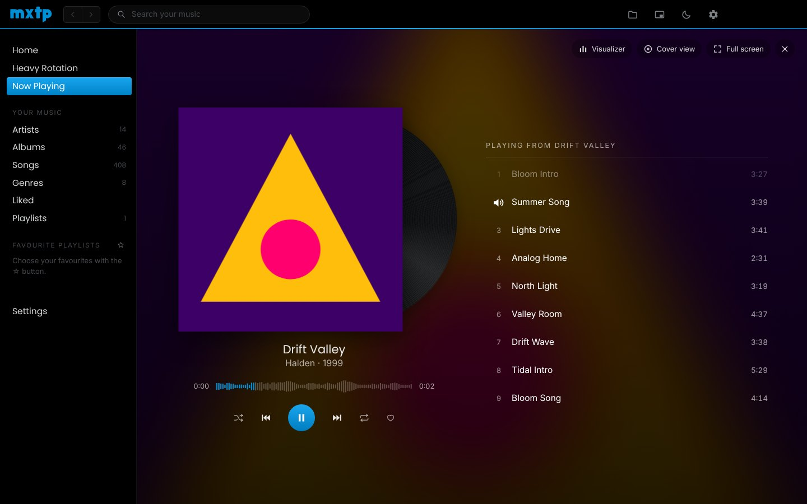
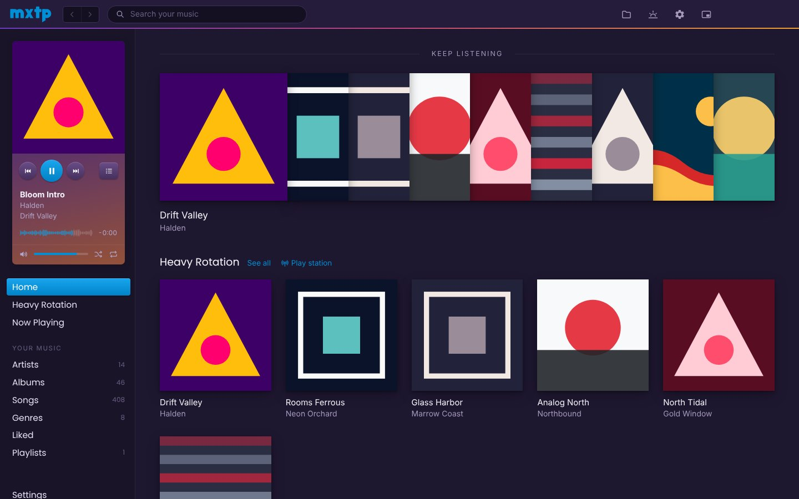
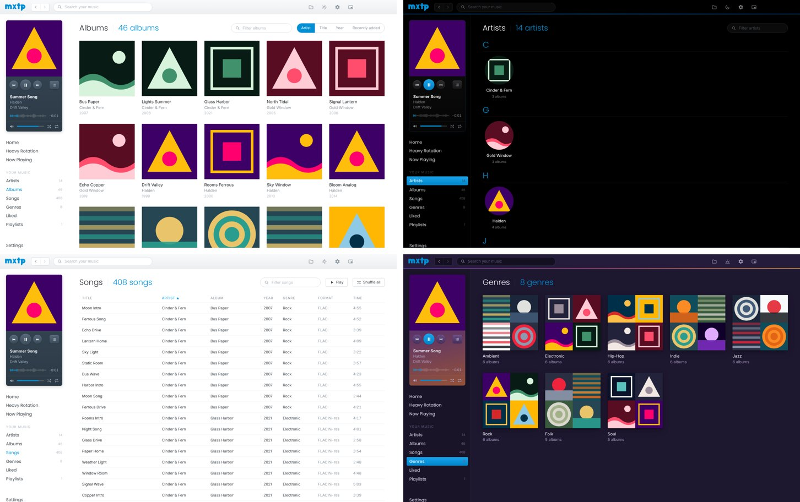
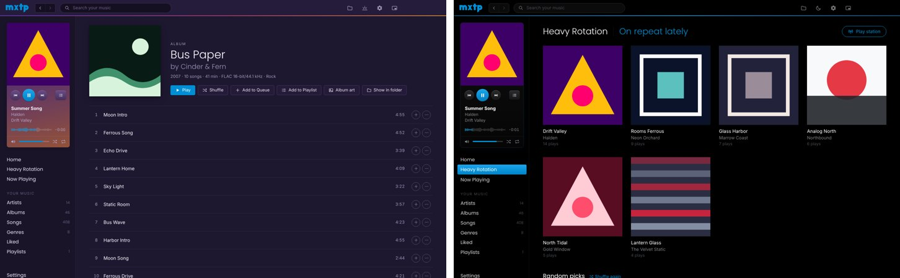
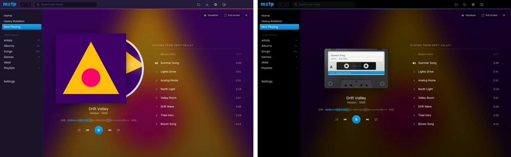
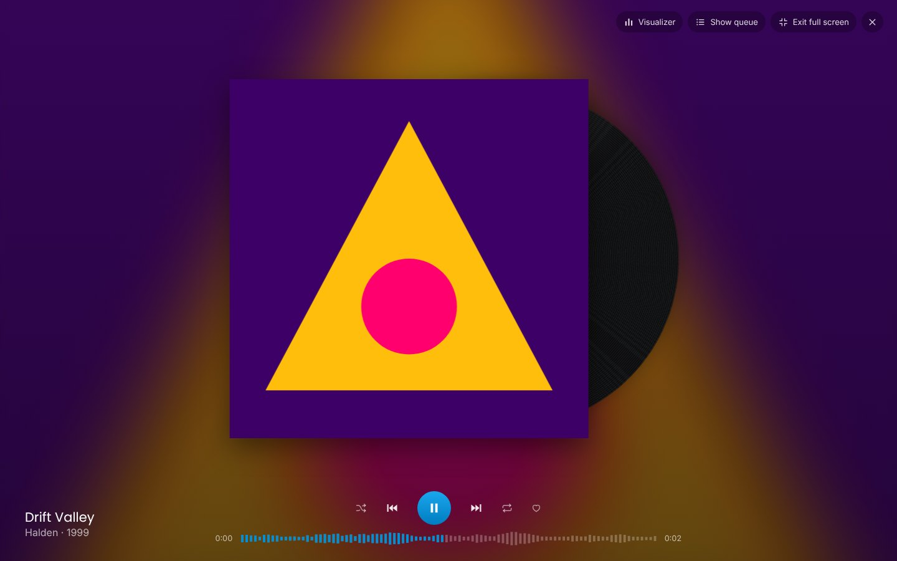
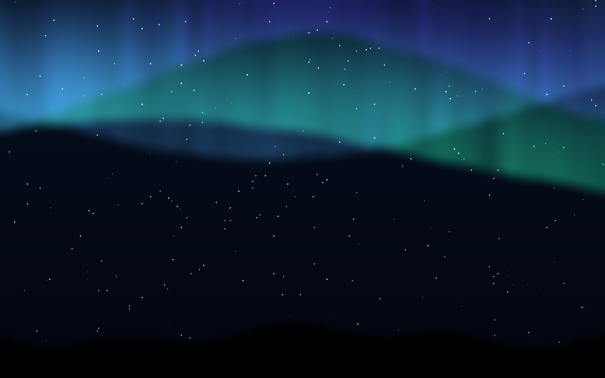
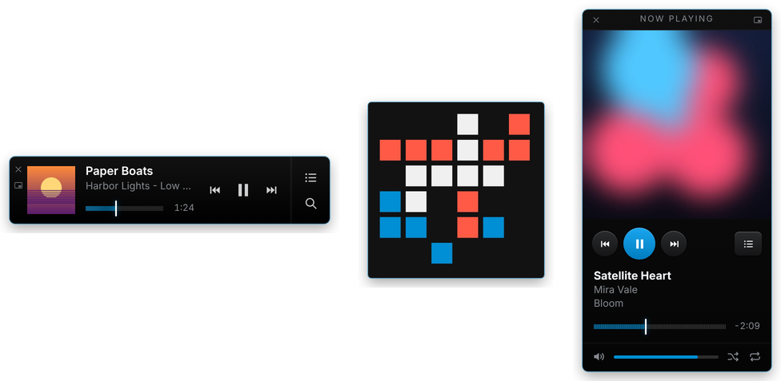
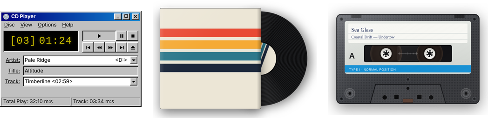
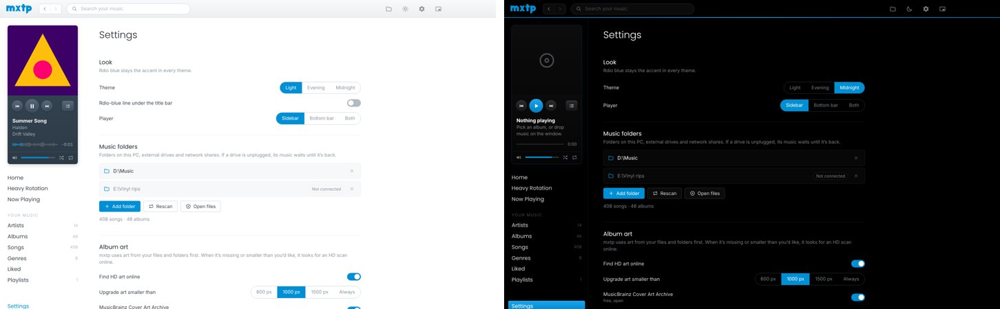

# mxtp

**A music player for the songs on your own drives. It's an ode to Rdio.**

Rdio was the music app that got it right, and then it was gone. mxtp is a love letter to it, built for your own music collection on Windows:

- **The name.** Rdio dropped the "a" from *radio*. mxtp drops the vowels from *mixtape*.
- **The layout.** Big album art first, the classic sidebar player, Heavy Rotation, and a Now Playing view that's all about the record.
- **The colours.** Rdio blue is the accent in every theme, with Rdio's clean Light look, plus Evening and Midnight.

It's also what Windows Media Player should have become: it plays almost any audio file on your computer, external drives or network, with HD album art and a pile of visualizers and desktop mini players.

<a href="../../releases/latest"><b>⬇ Download the latest release</b></a> &nbsp;·&nbsp; Windows 10 and 11 &nbsp;·&nbsp; free and open source (MIT)

---

## Download

| File | What it is |
|---|---|
| **mxtp-Setup.exe** | Installer, with Start menu and desktop shortcuts, and "Open with mxtp" for music files. |
| **mxtp.exe** | Portable: runs straight away, nothing to install. |
| **mxtp-build-it-yourself.zip** | The source with **build.bat**, to build it on your own PC. |

The exes aren't code-signed, so Windows may say "Windows protected your PC" the first time. Click **More info → Run anyway**.

**First run:** your Windows **Music** folder is added automatically. Add more folders, external drives or network shares in **Settings → Music folders**. You can also drop files or folders on the window, press **Ctrl+O**, or right-click a file in Explorer and choose **Open with → mxtp**.

---

## Your library

**Artists, Albums, Songs and Genres**, each with its own page. Albums sort by artist, title, year or recently added. Songs is a full sortable table with format and quality. Big letter headers make long lists easy to jump through.

- **Heavy Rotation:** your most-played albums in Rdio's big square grid, plus Recently added, Random picks and Most played. **Play station** shuffles it all into one mix.
- **Liked:** right-click any song and choose **Like** (the heart). Everything you like collects under **Your music → Liked**.
- **Playlists:** its own page. Create, rename, reorder and delete playlists, add whole albums, and **star** a playlist to keep it in the sidebar. The sidebar only shows your starred ones.
- **Watches your folders** and picks up new music by itself.
- **Unplugged drives** are remembered: their albums are hidden until you plug the drive back in, and nothing is deleted.

## Plays almost anything

**Plays directly:** MP3, AAC / M4A / M4B, FLAC (24-bit / 192 kHz and beyond), WAV, Ogg Vorbis, Opus and WebM audio.

**Converted on first play:** ALAC, AIFF / AIFC, WMA / ASF, APE (Monkey's Audio), WavPack, DSD (DSF / DFF), Musepack, TTA, TAK, OptimFROG, AC3, DTS, MKA, CAF, AU / SND, AMR, Speex, W64 and MP2. These are converted to FLAC on the fly with the bundled ffmpeg, which takes a moment the first time. The converted copies are kept in a cache of up to 3 GB.

Your music files are **never modified**.

## HD album art

mxtp uses the biggest cover in the album's folder (`cover.jpg`, `folder.jpg`, `front.png`…) or embedded in the files. If that's missing or too small, it can fetch an HD scan from:

- the **MusicBrainz Cover Art Archive** (free and open)
- **Discogs**, if you add a free personal token
- **Apple Music's catalogue**, up to 3000 px

On any album, **Album art → Look up HD art online** searches again, and **Choose art from a file…** picks your own image.

## Now Playing

- Your album as a **vinyl record**, a **CD** (printed cover or shiny underside) or a **cassette**.
- **Right-click the record, CD or cassette** to switch formats.
- The record or CD slides out of its sleeve while playing and **back in when you pause**.
- The cassette plays out of its case, with turning hubs and tape moving across with the song. Pause it and you see its case with the album art.
- A waveform scrubber drawn from the real audio, the release year under the artist, and the queue beside it.
- **Double-click an empty spot** (or press **F**) for full screen.
- **Cover view:** full screen with just the album, the song and the controls, no queue.
- **The heart** in every player (Now Playing, the sidebar card, the bottom bar) likes the song: an outline until you like it, then filled pink.

## Visualizers

Press **M** or use the Visualizer button on Now Playing. **V** opens the list, **← →** steps through them. There are 23:

- **Classic media player:** Spectrum, Scope, Mist, Inferno, Spikes, Particles, Circles, Color Wash, Swirl, Lissajous and Ridgeline
- **Album art:** Album Glow and Turntable
- **Party:** Disco Ball, Tunnel, Kaleidoscope and Fireworks
- **Retro:** Cassette Deck, Hi-Fi Rack, Neon Highway and Starfield
- **Nature:** Aurora
- **Console:** Earth, which plays the Earth video that comes with mxtp. In Settings → Visualizers you can switch it to your own video, or to a drawn globe.

They react to the real audio, smoothed so calm music stays calm.

## Mini players

A little player for your desktop, from the title bar or the tray. Right-click it to switch styles, keep it on top of other windows or behind them, lock its position or resize it.

## Themes

- **Light:** Rdio's clean 2015 look. It can have an optional Rdio-blue line under the title bar (off by default).
- **Evening:** **Purple**, **Amber**, or **Both** (purple fading into an amber sunset). Each has its own fading neon line.
- **Midnight:** true black with Rdio blue.

Pick one from the theme menu in the title bar, or in Settings. The player can be the classic sidebar card, a bottom bar, or both.

## Settings

The cog at the top goes straight to Settings:

| Section | What's there |
|---|---|
| **Look** | Theme · Evening tone · Rdio-blue line (Light) · player: sidebar, bottom bar or both |
| **Music folders** | Add or remove folders and drives · rescan · open files |
| **Album art** | Find HD art online · upgrade art smaller than 400 / 1000 / 1500 px, or always · each art source on or off · Discogs token |
| **Now Playing** | Format: vinyl, CD or cassette · CD: printed cover or shiny underside · cassette: out of its case, or on its own · tilt the record under the mouse |
| **Visualizers** | Earth plays: the Earth video, your own video, or a drawn globe |
| **Mini player** | Show it · style: Bar, Classic, Square, CD Player, Vinyl or Cassette · on top or on the desktop · show queue · lock position · square size |
| **Window** | Keep playing in the tray when the window closes |

## Little touches

- **Taskbar controls:** hover over mxtp in the Windows taskbar for previous, play/pause, next and like buttons under the preview.
- **Icons for every theme:** the `icons` folder next to mxtp (usually `%LOCALAPPDATA%\Programs\mxtp\resources\icons`) has an icon for Light, each Evening tone, Midnight and Rdio blue. Right-click your shortcut → Properties → **Change Icon…** → Browse.
- **A themed installer:** in the spirit of the Rdio era, with the mxtp logo. When you update, it uses the same theme you've set in the app.
- **Favourite playlists:** the ☆ next to "Favourite playlists" in the sidebar picks which playlists show there.

## Keyboard

Space: play / pause · Ctrl + → / ←: next / previous · Ctrl + F: search · Ctrl + O: open files · M: visualizers · F: full screen · Esc: back

---

And that's just the start. **mxtp is filled with little secrets and treasures for anyone who loves nostalgia.** Go and find them.

---

## Build it yourself

1. Download **mxtp-build-it-yourself.zip** from the [latest release](../../releases/latest), or clone this repo.
2. Double-click **build.bat**. It installs Node.js if needed, downloads Electron and the ffmpeg tools, and builds the app.
3. The `out` folder opens with **mxtp.exe** and **mxtp-Setup.exe**. The build tools (about 700 MB) are deleted afterwards to save space.

For development: `npm install`, then `npm start`.

Your settings, plays and playlists are kept in `%APPDATA%\mxtp`.

## Sister apps

- **[Bndcmp](https://github.com/SolarTrey/bndcmp):** the same Rdio spirit, for Bandcamp.
- **Zudio:** the same player, Zune-style (coming soon).

## Not affiliated

mxtp is an independent fan project. It isn't affiliated with or endorsed by Rdio, Microsoft or any other company; their names are used only to describe what this pays tribute to.

## License

[MIT](LICENSE)
