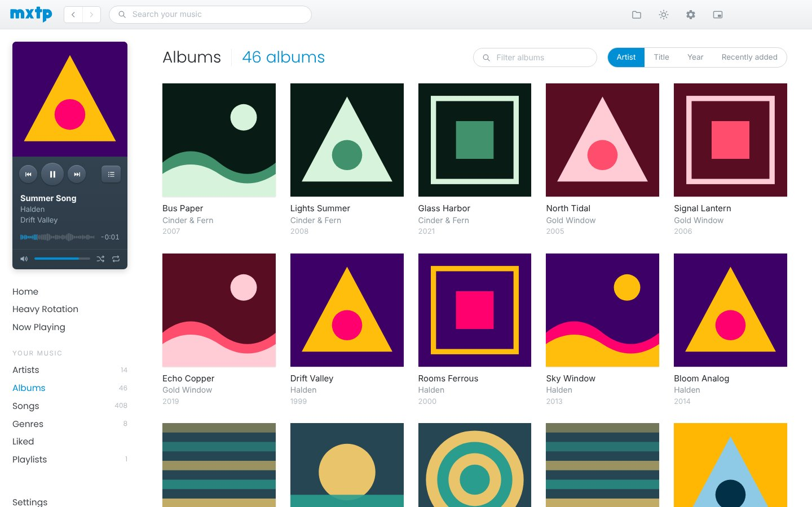
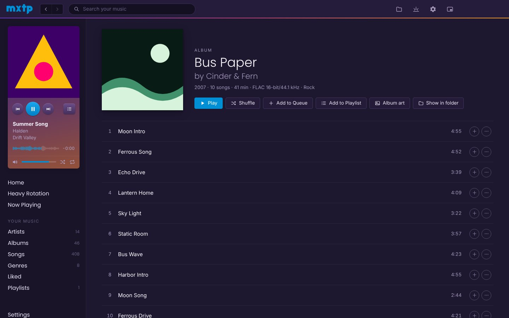
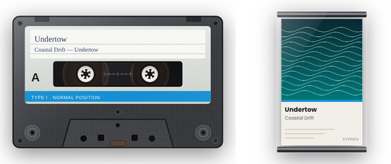

# mxtp

**A Windows music player for the music on your own drives, in the spirit of Rdio and the old Windows Media Player.**

It has the Light, Evening and Midnight themes, the classic sidebar player, Now Playing with vinyl, CD or cassette, visualizers, and mini players for your desktop. It's the local-music sister of [Bndcmp](https://github.com/SolarTrey/bndcmp).

<a href="../../releases/latest"><b>⬇ Download the latest release</b></a> &nbsp;·&nbsp; Windows 10 and 11 &nbsp;·&nbsp; free and open source (MIT)

## Download

| File | What it is |
|---|---|
| **mxtp-Setup.exe** | Installer, with shortcuts and "Open with mxtp" for music files. |
| **mxtp.exe** | Portable: runs straight away, nothing to install. |
| **mxtp-build-it-yourself.zip** | The source with **build.bat**, to build it on your own PC. |

The exes aren't code-signed, so Windows may say "Windows protected your PC" the first time. Click **More info → Run anyway**.

## Build it yourself

1. Unzip, open the `mxtp` folder and double-click **build.bat**.
2. It installs Node.js if needed, downloads Electron plus the ffmpeg/ffprobe tools, and builds the app.
3. The `out` folder opens with:
   - **mxtp.exe**: runs straight away.
   - **mxtp-Setup.exe**: installs it, with shortcuts and "Open with mxtp" for music files.

Windows will say "Windows protected your PC" the first time: click **More info → Run anyway**.

## First run

mxtp adds your Windows **Music** folder automatically. Add more folders, including external drives and network shares, in **Settings → Music folders**. If a drive is unplugged, its albums are hidden until you plug it back in; nothing is deleted. mxtp watches your folders and picks up new music by itself.

You can also drop files or folders on the window, press **Ctrl+O**, or right-click a file in Explorer and choose **Open with → mxtp**.

## Formats

MP3, AAC/M4A, FLAC (up to 24-bit/192 kHz and beyond), WAV, Ogg Vorbis and Opus play directly.
ALAC, AIFF, WMA, WavPack, APE, TTA, DSD (DSF/DFF), Musepack, AC3/DTS, MKA and other formats are converted to FLAC the first time you play them, which takes a moment. The converted copies are kept in a cache of up to 3 GB.

## Album art

mxtp uses, in order:
1. the biggest image in the album's folder (`cover.jpg`, `folder.jpg`, `front.png`…) or embedded in the files
2. if that's missing or smaller than 1000 px (you can change this), an HD scan from:
   - **MusicBrainz Cover Art Archive** (free and open)
   - **Discogs**, if you paste a free personal token in Settings (Discogs → Settings → Developers)
   - **Apple Music's catalogue**, up to 3000 px

On any album, **Album art → Look up HD art online** forces a new search, and **Choose art from a file…** picks your own image.
Art is cached in `%APPDATA%\mxtp\cache\art`; your music files are never modified.

## What's new

- **Liked:** right-click any song and choose **Like** (the heart). Everything you like is under **Your music → Liked**.
- **Playlists** has its own page. Star a playlist to keep it in the sidebar; the sidebar only shows your starred ones.
- **Right-click the record, CD or cassette** on Now Playing to switch formats (also in Settings).
- The **cog** at the top goes straight to Settings. Visualizers are still on Now Playing, or press **M**.
- Every Evening tone (Purple, Amber, Both) has its own neon line under the title bar. **Light** can have an Rdio-blue one: Settings → Theme (off by default).
- **Smaller:** English-only Chromium languages and maximum compression, and build.bat clears out ~700 MB of build tools when it's done.

## Themes

Click the theme button in the title bar, or go to **Settings → Look**: **Light**, **Evening** (purple, amber or both) and **Midnight**. Rdio blue stays the accent in all three. Choose the classic sidebar player, the bottom bar or both.

## Mini player

Right-click the mini player for its options: **Bar** (with an optional queue), **Classic** (the 2011 sidebar card), **Album art square**, **CD Player** (a late-90s desktop CD player), **Vinyl** (the record slides out of its sleeve while playing) or **Cassette** (the cassette while playing, its case when paused). It can stay on top of other windows or sit on the desktop.

## Music mode

Press **M**, or use the bars icon. There are 24 visualizers. Press **V** for the list and **←/→** to switch. New in mxtp: Lissajous, Ridgeline, Aurora, Album Glow, Turntable, Fireworks, Hi-Fi Rack and Neon Highway.

## Files

- `src/main/library.js`: scanning, tags (via ffprobe), albums, format conversion, waveforms
- `src/main/art.js`: album art (local + online)
- `src/main/media.js`: streams songs and art to the window (`media://`)
- `src/renderer/app.css` + `skins.css`: the look (both apps share one codebase; `src/product.json` picks the app)
- `src/renderer/widget.*`: the mini players
- `src/renderer/visualizers.js`: Music mode

Your settings, plays and playlists are in `%APPDATA%\mxtp`.

## Not affiliated

mxtp is an independent fan project, not affiliated with Rdio or Microsoft.

## License

[MIT](LICENSE)
